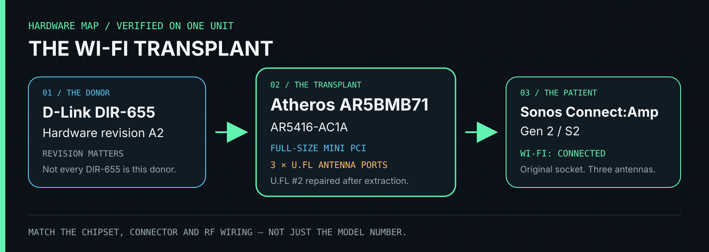
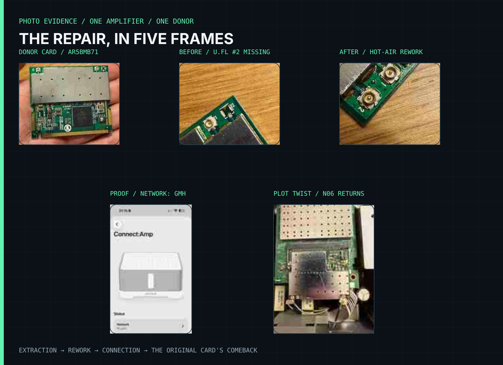

# Using a D-Link DIR-655 Wi-Fi card in a Sonos Connect:Amp Gen 2

I bought a cheap Connect:Amp Gen 2 with faulty Wi-Fi. Ethernet worked, the amp worked, and it still ran on S2, so replacing the wireless card seemed worth a try.

The original card is a Sonos/Alpha Networks **WMP-N06**. Those are difficult to find, so I used an **Atheros AR5BMB71** taken from a **D-Link DIR-655 A2** instead. That card worked in the Sonos.

Then I put the original N06 back in and it worked too, which rather messed up the diagnosis. More on that below.

## The cards

| | Original | Replacement I tested |
|---|---|---|
| Card | Sonos / Alpha Networks WMP-N06 | Atheros AR5BMB71 |
| Chip | AR5416 family | Marked AR5416-AC1A |
| Connector | Full-size Mini PCI | Full-size Mini PCI |
| Antenna sockets | Three U.FL | Three U.FL |

The important part here is **full-size Mini PCI**, not Mini PCIe. They are not interchangeable.

The DIR-655's hardware revision also matters. My donor has **H/W Ver.: A2** on the label and contained the AR5BMB71. Other DIR-655 revisions can contain different hardware, so the router model alone does not tell you what card you will get.

## Removing the donor card went badly

While extracting the card, I tore off U.FL socket **2**. Fortunately the pads were still on the board and looked usable.

I added flux and soldered the connector back on with hot air. The centre contact carries the RF signal; the outer joints provide ground and hold the socket in place, so all of them matter.

This is easy damage to avoid if you have the right extraction tool. Pull U.FL plugs straight up, not sideways, and do not use the coax lead to lever them off. Labelling the three antenna leads before disconnecting them is also a good idea.

## Testing it in the Sonos

I installed the repaired AR5BMB71 in the Connect:Amp, reconnected all three antennas, and powered it up. The amp joined my wireless network. The Sonos app showed **Network: gmh**.

That confirms that this particular card works in my Connect:Amp Gen 2. I did not measure range, throughput, or each RF chain separately, so I would not read more into the test than that.

These photos show the donor card, the broken socket, the repair, the app result, and the original card after I reinstalled it:

## The original card worked again

After testing the donor, I reinstalled the WMP-N06. It connected as well.

The Wi-Fi was definitely faulty when I got the amp, but the N06 clearly was not permanently dead. It could have been an intermittent card fault, a bad contact in the socket, an antenna connection, or something else that changed when I took everything apart and put it back together. Reseating the card means I cannot cleanly separate those possibilities now.

For the moment I am using the original N06 and keeping the repaired AR5BMB71 as a known-working spare. If the problem returns, swapping cards should at least make it easier to narrow down.

## If you want to try the same thing

- This was a **Connect:Amp Gen 2**. I have not tested other Sonos models or generations.
- Check the donor router's exact hardware revision before buying it.
- Make sure the card is **full-size Mini PCI**, not Mini PCIe.
- Check the number of antenna connections and label the leads before removal.
- Reconnect the antennas before powering up the radio.
- A card being detected is not the same as connecting once, and connecting once is not the same as being reliable for weeks.

The amp contains mains-powered circuitry. Unplug it before opening it and leave it alone if you are not comfortable working around mains and ESD-sensitive electronics.

## If you test another card

Feel free to open an issue or pull request with the Sonos model and generation, the original and replacement card models, any visible chip markings, and the result. If the card came out of a router, include the exact hardware revision. A few more tested combinations would make this much more useful than my single example.

## Background reading

- [Sonos community: Connect:Amp housing disassembly](https://en.community.sonos.com/components-architectural-228996/connect-amp-housing-disassembly-6739706)
- [iFixit: Sonos Connect Wi-Fi card replacement](https://www.ifixit.com/Guide/Sonos+Connect+WIFI+Card+Replacement/61568) — this is for a different Sonos model, but the card replacement is useful background.

All photos here are from this repair.
