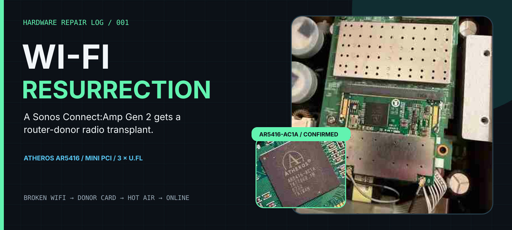
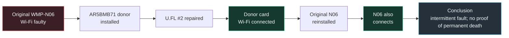

# Wi-Fi Resurrection: a Sonos Connect:Amp Gen 2 radio transplant

> A cheap Connect:Amp. A seller who said the Wi-Fi was broken. A router harvested for parts. One tiny RF connector ripped clean off. And, eventually, a working wireless amp.
>
> The original **WMP-N06 had genuinely failed in this unit**. The surprise was that “failed” did not turn out to mean “permanently dead.”

**Verified result:** an **Atheros AR5BMB71 / AR5416-AC1A** card removed from a **D-Link DIR-655 hardware revision A2** worked in my **Sonos Connect:Amp Gen 2** after I repaired one of its U.FL antenna connectors.

This is a repair log, not a promise that every AR5416 card or every DIR-655 revision will work. Sample size: one very cooperative amplifier.

## The short version

| Item | What happened |
|---|---|
| Patient | Sonos Connect:Amp Gen 2 / S2 |
| Initial symptom | Ethernet and amplifier functions worked; wireless operation was faulty |
| Original radio | Alpha Networks/Sonos WMP-N06, AR5416 family, full-size Mini PCI, three U.FL ports |
| Donor | D-Link DIR-655 **A2** |
| Transplant | Atheros **AR5BMB71**, visibly marked **AR5416-AC1A** |
| Extra damage | U.FL connector **2** tore off while removing the donor card |
| Repair | Connector reattached with flux and hot air; the pads were still usable |
| Donor result | **Worked in the Connect:Amp and joined my Wi-Fi** |
| Plot twist | The original WMP-N06 also worked when I reinstalled it later |
| Honest diagnosis | An intermittent card, socket-contact, antenna-contact, or configuration-state failure—not a proven permanently dead N06 |

## 1. The listing said the magic words

“Wi-Fi defective” is usually a reason to scroll past. On a cheap Sonos Connect:Amp Gen 2, it sounded more like a project.

The important detail was that everything else appeared healthy. Ethernet worked. The amplifier worked. The unit could live in the current Sonos/S2 world. The missing piece was wireless. That is a much better starting point than a completely dead amp: the power supply, main logic, and output stage were already demonstrating signs of life.

The original suspect was the removable **WMP-N06** radio card. This was not an abstract software-only repair attempt. There was a physical module, a physical slot, and three small RF connections that could all participate in the failure.

The useful discovery was that the radio is a **full-size Mini PCI card**, not a permanently soldered Wi-Fi chip and not the newer, electrically incompatible Mini PCIe format. If the original card had failed, a compatible replacement was at least physically plausible.

## 2. Find a donor, not a unicorn

Original WMP-N06 cards are awkward to source. Instead of hunting indefinitely for the exact Sonos-branded part, I looked for another card built around the same Atheros generation.

The donor turned out to be a **D-Link DIR-655 A2**. Its removable wireless card was an **AR5BMB71**, and the chip marking left no ambiguity about the main silicon: **AR5416-AC1A**.

The router’s hardware revision mattered. “DIR-655” alone was not enough; later revisions can use different hardware. The label on this unit said **H/W Ver.: A2**, which was the version I wanted.

| | Original card | Donor card |
|---|---|---|
| Card | Sonos / Alpha Networks WMP-N06 | Atheros AR5BMB71 |
| Main radio family | AR5416 | AR5416-AC1A |
| Host interface | Full-size Mini PCI | Full-size Mini PCI |
| Antenna connections | Three U.FL | Three U.FL |
| Observed result | Faulty initially; worked again after later reinstallation | Worked after connector repair |

Here is the visual evidence, from the donor card and connector damage through the successful app test and the N06’s unexpected return:

## 3. The extraction did not go cleanly

The card came out of the router. Connector **2** did not come through the experience intact.

The little U.FL jack had torn away from the board. That turned a straightforward card swap into an RF rework job. A U.FL connector is not just one electrical contact: the centre contact carries the RF signal, while the outer shell and its solder joints provide ground and mechanical support.

The good news was visible under magnification: the pads still looked usable. No obvious missing copper island, no dramatic trace rebuild, no need to invent a new mounting system.

I used flux and hot air to reattach the connector, then inspected the joints. The repaired card still had to prove itself electrically; a connector can look perfectly seated and still hide a bad centre contact. The eventual Sonos test therefore mattered more than the cosmetic result.

**Lesson for anyone repeating this:** U.FL connectors are easy to damage when a cable is pulled at an angle or used as a handle. Disconnect them straight up with an appropriate tool, support the board, and label every antenna lead before removal.

## 4. Proof of life

The repaired AR5BMB71 went into the Connect:Amp’s original Mini PCI socket. All three antenna leads went back onto the card. Then came the only benchmark that mattered: would Sonos actually use it?

Yes.

The app showed the Connect:Amp with **Network: gmh**. The donor was no longer a chipset theory or a pile of matching specifications. It was a working radio in the actual target device.

That single test established the most useful compatibility result of the project:

> **A DIR-655 A2’s AR5BMB71 / AR5416 card can work in at least one Sonos Connect:Amp Gen 2.**

## 5. Then the original card came back

With the donor working, I reinstalled the original WMP-N06.

It worked too.

That does not erase the original fault. It does invalidate the much stronger claim that the N06 was permanently destroyed. A card that works after reseating is not a card whose silicon has been proven dead.

The evidence now points to an **intermittent failure**: possibly the N06 itself, its socket contact, an antenna connection, or a wireless configuration state that changed during the repair process. Reseating cards and reconnecting antennas can hide exactly this kind of fault, which is why the final chapter is less satisfying than “bad chip replaced” but much more honest.

My practical choice was to keep the original N06 installed for an extended real-world test and retain the repaired AR5BMB71 as a **known-working spare**. If the original failure returns, the donor gives me an immediate controlled comparison instead of another scavenger hunt.

## 6. What this repair does—and does not—prove

| Claim | Status |
|---|---|
| The Connect:Amp Gen 2 uses a removable full-size Mini PCI radio | Confirmed by direct inspection |
| This AR5BMB71 has an AR5416-AC1A | Confirmed by the chip marking |
| This donor card worked in my Connect:Amp Gen 2 | Confirmed in the Sonos app |
| The repaired U.FL connector 2 was part of the successful system test | Confirmed; individual RF-chain performance was not measured |
| Every AR5416 Mini PCI card will work in every Connect:Amp | **Not proven** |
| Every DIR-655 contains the same donor card | **False assumption; check the hardware revision** |
| The original WMP-N06 was permanently dead | **Not proven; it later worked again** |

The transferable result is deliberately narrow: matching the **radio generation, host interface, antenna arrangement, and actual hardware revision** can pay off. The model number printed on a router box is not a sufficient compatibility specification.

## 7. Field notes for the next attempt

1. **Confirm the Sonos generation.** This log concerns a Connect:Amp **Gen 2**, not every product carrying a similar name.
2. **Check the router’s H/W revision.** My donor was a DIR-655 **A2**. Do not assume another revision contains this module.
3. **Use full-size Mini PCI, not Mini PCIe.** Similar-looking names do not make the sockets interchangeable.
4. **Photograph and label the antenna leads.** Three RF ports are not an invitation to improvise.
5. **Treat U.FL connectors as fragile.** Pull straight up, avoid lateral force, and never use the coax cable as a handle.
6. **Inspect repaired RF joints critically.** The centre signal contact and outer ground joints all matter.
7. **Test the installed result.** A matching chipset is encouraging; a visible Wi-Fi connection in the Sonos app is evidence.
8. **Keep a known-good spare.** Intermittent faults are much easier to isolate when a second compatible card is available.

## Safety

The Connect:Amp contains mains-powered circuitry and large power-supply components. Disconnect it from mains before opening it, avoid unnecessary contact with the power-supply and amplifier sections, and do not attempt internal work if you are not comfortable with the electrical and ESD risks. Reconnect the required antenna leads before powering the radio. This project log is documentation, not an electrical-safety certification.

## Help expand the compatibility list

If you test another card, open a pull request with:

- Sonos model and generation;
- original card model;
- replacement card model and chip marking;
- donor router model and exact hardware revision, if applicable;
- Mini PCI versus Mini PCIe confirmation;
- number of antenna connections;
- Sonos app result;
- any rework or antenna changes required.

Please distinguish **“detected”**, **“connected once”**, and **“stable in daily use”**. Those are three very different repair outcomes.

## Related background

- [Sonos community: Connect:Amp housing disassembly](https://en.community.sonos.com/components-architectural-228996/connect-amp-housing-disassembly-6739706)
- [iFixit: Sonos Connect Wi-Fi card replacement](https://www.ifixit.com/Guide/Sonos+Connect+WIFI+Card+Replacement/61568) — a related but **different Sonos model**, useful as background rather than a Connect:Amp-specific guide.

*All repair photos and test results in this log are from this project. No stock-photo Wi-Fi miracles were required.*
